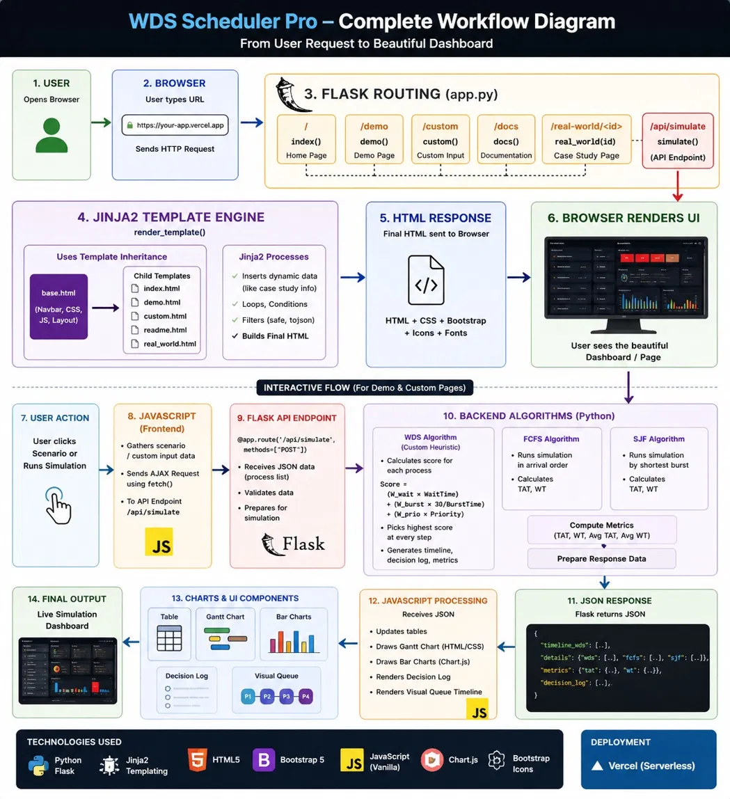

\# ⚡ WDS Scheduling Engine (Weighted Dynamic Scoring)

\> \*\*A Next-Generation Non-Preemptive CPU Scheduler.\*\*

\> \*Designed for High-Performance Computing, Cloud Clusters, and Autonomous Systems.\*

\---

\## 📖 Project Objective

Modern computing environments (like 5G Edge Gateways and AI Training Clusters) suffer from inefficiencies when using standard CPU schedulers:

\* \*\*FCFS (First-Come-First-Serve):\*\* causes the "Convoy Effect" (UI freezes behind background tasks).

\* \*\*SJF (Shortest Job First):\*\* causes "Starvation" (Long tasks never run).

\*\*The Solution:\*\*

The \*\*Weighted Dynamic Score (WDS)\*\* algorithm. It utilizes a \*\*Cooperative Multitasking Architecture\*\* where tasks yield control at specific checkpoints. The scheduler calculates a dynamic score based on \*\*Efficiency\*\*, \*\*Fairness\*\*, and \*\*Priority\*\* to decide the next task.

\---

\## ⚙️ The WDS Formula

The engine calculates a score ($S$) for every waiting process in real-time:

$$S = (W\_{wait} \times T\_{waiting}) + (W\_{burst} \times \frac{30}{T\_{burst}}) + (W\_{prio} \times P\_{level})$$

\* \*\*$W\_{wait}$ (Aging Factor):\*\* Prevents starvation by boosting the score of waiting tasks.

\* \*\*$W\_{burst}$ (Efficiency):\*\* Favors short jobs to reduce system latency.

\* \*\*$W\_{prio}$ (Urgency):\*\* Allows critical operations (e.g., "Emergency Braking") to override standard logic.

\---

\## 🌍 Real-World Scenarios

This project simulates WDS performance in four specific industries:

\| Industry | The Problem | The WDS Solution |

\| :--- | :--- | :--- |

\| \*\*🤖 AI Clusters\*\* | Long training epochs block checkpoint saves. | \*\*Yield Points:\*\* WDS pauses training to run quick saves. |

\| \*\*📡 5G Edge\*\* | 4K video streams block health alert packets. | \*\*Packet Yielding:\*\* Emergency packets get priority override. |

\| \*\*🚗 Autonomous OS\*\* | Map downloads block Lidar obstacle detection. | \*\*Context Switch:\*\* Lidar gets instant CPU access. |

\| \*\*☁️ Cloud Functions\*\* | Cold starts delay user login requests. | \*\*Aging Factor:\*\* Login requests gain score while waiting. |

## 🔄 Complete Project Workflow

This workflow shows the complete flow of the WDS Scheduler from the user request through Flask routing, scheduling algorithms, JSON responses, JavaScript interaction, and final visualizations.

It also shows how the frontend, backend, Jinja2 templates, Fetch API, and Chart.js work together in the application.





\<link href="https\://fonts.googleapis.com/css2?family=Poppins\:wght\@300;400;600;700&display=swap" rel="stylesheet">

\

*\<!-- HERO SECTION -->*

\

    \<h1 class="display-5 fw-bold mb-2">Project Documentation\</h1>

    \

        Technical Breakdown, User Guide & Testing Instructions

    \

    \<a class="btn btn-outline-light fw-bold" href="/">

        Back to Dashboard

    \</a>

\

\

    \<!-- HOW TO RUN -->

    \

        \<h3>How to Run the Simulator\</h3>

        \

            \

                \

                    \

                        OPTION 1: Demo Mode

                    \

                    \

                        Loads a pre-set "Starvation Scenario"

                        (1 Long Job vs. 5 Short Jobs).

                        Use this to instantly visualize how WDS

                        prevents the long job from being blocked forever.

                    \

                \

            \

            \

                \

                    \

                        OPTION 2: Custom Input

                    \

                    \

                        Enter your own Arrival Times, Burst Times,

                        and Priorities. Use this mode to test specific

                        homework problems or stress-test the algorithm.

                    \

                \

            \

        \

    \

    \<!-- PROJECT PURPOSE -->

    \

        \<h3>Project Purpose\</h3>

        \

            \<strong>Why was this built?\</strong>

            Standard operating system schedulers like FCFS and SJF

            are rigid. They optimize for \<em>either\</em> speed

            \<em>or\</em> fairness, but never both.

        \

        \

            The goal of this project is to demonstrate a

            \<strong>Hybrid Heuristic Algorithm (WDS)\</strong>

            that uses a weighted formula to dynamically adapt its behavior.

            It proves that we can achieve high throughput (Speed)

            without sacrificing user experience (Fairness)

            in Cloud and 5G environments.

        \

    \

    \<!-- WDS FORMULA -->

    \

        \<h3>The WDS Formula\</h3>

        \

            Instead of a rigid rule, WDS calculates a real-time score

            for every waiting process. The highest score wins.

        \

        \

            Score =

            (W\_wait × WaitTime) +

            (W\_burst × 30/BurstTime) +

            (W\_prio × Priority)

        \

        \<table class="table-custom">

            \<thead>

                \<tr>

                    \<th width="30%">

                        Component

                    \</th>

                    \<th>

                        Why we need it? (The Logic)

                    \</th>

                \</tr>

            \</thead>

            \<tbody>

                \<tr>

                    \<td>

                        \<strong class="text-info">

                            W\_wait (Aging)

                        \</strong>

                    \</td>

                    \<td>

                        Ensures that if a task waits for a long time,

                        its score grows massive, forcing the CPU to pick it.

                        (Solves Starvation).

                    \</td>

                \</tr>

                \<tr>

                    \<td>

                        \<strong class="text-warning">

                            W\_burst (Efficiency)

                        \</strong>

                    \</td>

                    \<td>

                        Gives a bonus to short jobs.

                        This clears the queue quickly and lowers

                        average system latency.

                    \</td>

                \</tr>

                \<tr>

                    \<td>

                        \<strong class="text-danger">

                            W\_prio (Urgency)

                        \</strong>

                    \</td>

                    \<td>

                        Allows critical tasks

                        (e.g., "System Crash Alert")

                        to override the math and run immediately.

                    \</td>

                \</tr>

            \</tbody>

        \</table>

    \

    \<!-- TESTING -->

    \

        \<h3 style="color: #fd7e14; border-color: #fd7e14;">

            For Developers: What to Test?

        \</h3>

        \

            If you are looking to find flaws or verify stability,

            try these specific edge cases in \<strong>Custom Mode\</strong>:

        \

        \<ul style="list-style: none; padding-left: 0;">

            \<li class="mb-3">

                \

                    TEST 1

                \

                \<strong>The Starvation Trap\</strong>

                \ 

                Add one massive job (Burst=100)

                followed by many tiny jobs (Burst=1).

                \ 

                \<em class="text-secondary">

                    Expected Result:

                \</em>

                The massive job should eventually run

                due to the "Aging Factor".

            \</li>

            \<li class="mb-3">

                \

                    TEST 2

                \

                \<strong>The Priority Override\</strong>

                \ 

                Add a long job, then add a short job

                with Priority=10.

                \ 

                \<em class="text-secondary">

                    Expected Result:

                \</em>

                The Priority=10 job should cut the line immediately.

            \</li>

            \<li class="mb-3">

                \

                    TEST 3

                \

                \<strong>The Zero Burst Crash\</strong>

                \ 

                Try entering a Burst Time of 0.

                \ 

                \<em class="text-secondary">

                    Expected Result:

                \</em>

                The system should handle it gracefully

                (internally converts to minimal burst)

                without crashing.

            \</li>

        \</ul>

    \

    \<!-- PROBLEM VS WDS SOLUTION -->

    \

        \

            \

                \<h3 class="text-danger"

                    style="border-color: #dc3545;">

                    The Problem

                \</h3>

                \

                    \<strong>FCFS:\</strong>

                    Causes "Convoy Effect"

                    (UI freezes behind background tasks).

                \

                \

                    \<strong>SJF:\</strong>

                    Causes "Starvation"

                    (Long videos never process if short texts keep coming).

                \

            \

        \

        \

            \

                \<h3 class="text-success"

                    style="border-color: #198754;">

                    The WDS Solution

                \</h3>

                \

                    \<strong>Hybrid Approach:\</strong>

                    Acts like SJF when the system is busy

                    to clear traffic, but switches to Fairness mode

                    for old tasks.

                \

                \

                    \<strong>Cooperative:\</strong>

                    Uses "Yield Points" to allow high-priority interruptions.

                \

            \

        \

    \

    \<!-- =========================================

         COMPLETE PROJECT WORKFLOW

         ========================================= -->

    \

        \<h3>

            Complete Project Workflow

        \</h3>

        \

            \

        \

        \

            This diagram shows the complete WDS Scheduler flow,

            from the user's request and Flask routing to Jinja2 rendering,

            JavaScript interaction, backend scheduling algorithms,

            JSON responses, and final visualizations.

        \

    \

    \<!-- TECH STACK -->

    \

        \<h3>

            Tech Stack

        \</h3>

        \

            \

                \<ul>

                    \<li>

                        \<strong>Backend Logic:\</strong>

                        Python (Flask)

                    \</li>

                    \<li>

                        \<strong>Algorithm:\</strong>

                        Custom Heuristic (O(N) Complexity)

                    \</li>

                \</ul>

            \

            \

                \<ul>

                    \<li>

                        \<strong>Frontend:\</strong>

                        HTML5, Bootstrap 5, Jinja2

                    \</li>

                    \<li>

                        \<strong>Deployment:\</strong>

                        Vercel (Serverless)

                    \</li>

                \</ul>

            \

        \

    \

\

*\<!-- FOOTER -->*

\<footer class="text-center text-secondary small py-4 mt-5 border-top border-secondary">

    © 2025 WDS Scheduler Project |

    Designed for OS Efficiency Research

\</footer>



\---

\## 🛠️ Tech Stack

\* \*\*Backend:\*\* Python (Flask)

\* \*\*Algorithm:\*\* Weighted Dynamic Scoring (Custom Heuristic)

\* \*\*Frontend:\*\* HTML5, CSS3, JavaScript (Fetch API)

\* \*\*Visualization:\*\* Chart.js (for Latency Graphs)

\---

\## 🚀 How to Run Locally

1\.  \*\*Clone the Repository\*\*

    \`\`\`bash

    git clone [https\://github.com/your-username/wds-scheduler.git]\(https\://github.com/your-username/wds-scheduler.git)

    cd wds-scheduler

    \`\`\`

2\.  \*\*Install Dependencies\*\*

    \`\`\`bash

    pip install -r requirements.txt

    \`\`\`

3\.  \*\*Run the Server\*\*

    \`\`\`bash

    python app.py

    \`\`\`

4\.  \*\*Open in Browser\*\*

    Visit \`http\://127.0.0.1:5000\`

\---

\## ☁️ Deployment

This project is deployed on \*\*Vercel\*\*.

1\.  Push code to GitHub.

2\.  Import repository into Vercel.

3\.  Vercel automatically detects the Python runtime via \`vercel.json\`.

\---

\### 📄 License

This project is for educational research purposes.

\## 🤝 Contributing & Issues

This project is open for viewing. \*\*Direct changes are restricted.\*\*

\* \*\*Found a bug?\*\* Please [Open a New Issue]\(https\://github.com/YOUR-USERNAME/os-el2025/issues/new) and describe the problem.

\* \*\*Want to fix it?\*\* Please Fork the repo and submit a Pull Request (PR) for review.
